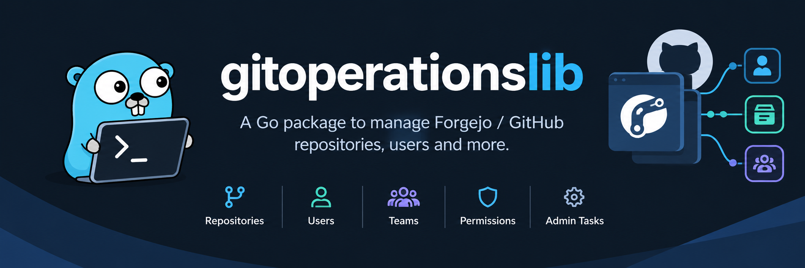

<p align="center">
  
</p>
___

# gitoperationslib

[](https://pkg.go.dev/github.com/jeanfrancoisgratton/gitoperationslib)

A Go library for managing git forges through one set of interfaces. Write your code once against `gitoperationslib.Client` and run it against **Forgejo** (the primary backend), **GitHub** or **Bitbucket Cloud**. Anything a forge cannot do is reported with a typed error. The library never skips part of a request without saying so.

**Covered:** repositories, branches and tags, branch and tag protection, releases and assets, pull requests and reviews, issues (with labels, milestones and comments), webhooks (managing them, including Forgejo's user, system and default webhooks and GitHub's delivery history, and receiving, verifying and decoding deliveries), Forgejo's git hooks, reading users, organisations and teams with any token (Forgejo and GitHub), your own account (e-mail addresses, SSH and GPG keys, profile, and Forgejo access tokens), CI secrets and variables (Forgejo Actions, GitHub Actions, Bitbucket Pipelines), commit history (a server-side `git log` with each commit's changed files), and Forgejo administration (managing users, organisations, teams). Transient failures are retried, and Forgejo accounts with two-factor authentication are supported.

## Documentation

| Document | Contents |
|---|---|
| **[__docs/USAGE.md](__docs/USAGE.md)** | The full guide: every package, interface, type and option, with examples and per-backend notes |
| [__docs/support_grid.md](__docs/support_grid.md) | Support level of every feature, per backend |
| [__docs/CHANGELOG.md](__docs/CHANGELOG.md) | Release history |
| [__docs/TODO.md](__docs/TODO.md) | Open items, planned work, and the reasons behind each limitation |
| [pkg.go.dev](https://pkg.go.dev/github.com/jeanfrancoisgratton/gitoperationslib) | API reference generated from the source |

## Installation

```sh
go get github.com/jeanfrancoisgratton/gitoperationslib
```

Versions follow [Semantic Versioning](https://semver.org) loosely: the library is written for its author's own tools, and a minor version may break the API when that makes it clearer. 1.9.0 did, reorganising how areas are reached; the [CHANGELOG](__docs/CHANGELOG.md) lists every change with what replaces it.

How it grows:
- Every area is an accessor on `Client` (`client.CI().Runners()`), on every backend; what a forge lacks answers `ErrNotSupported`. A new area adds an accessor, which breaks other implementations of `Client`, mocks included.
- Each area has a `Capability` bit, to tell beforehand what a backend supports.
- Minor versions may add struct fields, methods, sentinel errors, constants and backend options.

**Requirements:**
- Go 1.27.3 or later.
- Forgejo 15.0.0 or later. `forgejo.New` checks the server version and refuses older servers.
- GitHub: github.com, or GitHub Enterprise Server.
- Bitbucket: Bitbucket Cloud only. Data Center has a different API.

The module has two third-party dependencies, both used only by the GitHub backend: [`google/go-github`](https://github.com/google/go-github) (v93), and [`golang.org/x/crypto`](https://pkg.go.dev/golang.org/x/crypto), which encrypts Actions secrets the way GitHub requires (libsodium sealed box).

## Quick start

```go
package main

import (
	"context"
	"fmt"
	"log"
	"os"

	gol "github.com/jeanfrancoisgratton/gitoperationslib"
	"github.com/jeanfrancoisgratton/gitoperationslib/forgejo"
)

func main() {
	ctx := context.Background()

	client, err := forgejo.New(ctx, "https://git.example.com", forgejo.Token(os.Getenv("FORGEJO_TOKEN")))
	if err != nil {
		log.Fatal(err)
	}

	repo, err := client.Repos().Create(ctx, gol.CreateRepoOptions{
		Owner:      "acme",
		Name:       "widget",
		Visibility: gol.VisibilityPrivate,
		AutoInit:   true,
	})
	if err != nil {
		log.Fatal(err)
	}
	fmt.Println("created", repo.FullName, repo.CloneURL)

	// Every page of a list, as a Go iterator.
	for r, err := range gol.All(ctx, gol.ListOptions{PerPage: 50},
		func(ctx context.Context, o gol.ListOptions) (gol.Page[gol.Repo], error) {
			return client.Repos().List(ctx, "acme", o)
		}) {
		if err != nil {
			log.Fatal(err)
		}
		fmt.Println(r.FullName)
	}
}
```

To use another forge, change only the constructor:

```go
client, err := github.New(os.Getenv("GITHUB_TOKEN"))
client, err := bitbucket.New(bitbucket.APIToken(os.Getenv("BITBUCKET_EMAIL"), os.Getenv("BITBUCKET_TOKEN")))
```

[__docs/USAGE.md](__docs/USAGE.md) covers every area in detail.

## Architecture

```
gitoperationslib/             interfaces, domain types, errors, pagination  (no backend code)
├── forgejo/                  Forgejo backend      → internal/forgejoapi    (net/http)
├── github/                   GitHub backend       → google/go-github v93 + a small GraphQL client (+ x/crypto for secrets)
├── bitbucket/                Bitbucket backend    → internal/bitbucketapi  (net/http)
├── webhook/                  receiving deliveries (depends on the root package only)
├── local/                    reading a clone's .git: branches, upstreams, worktrees, commits, reflogs (no git client)
├── branchinfo/               a detailed branch list, from a clone, the server, or both
└── internal/
    ├── forgejoapi/           Forgejo transport: base URL, auth, pagination, errors, uploads
    ├── bitbucketapi/         Bitbucket transport: REST 2.0, pagination, errors
    ├── partial/              helpers for the Info calls (paging, tolerated refusals)
    ├── unsupported/          generated services answering ErrNotSupported, which backends embed
    └── contracttest/         one integration suite every backend must pass
```

| Package | Import path | Role |
|---|---|---|
| root | `github.com/jeanfrancoisgratton/gitoperationslib` | `Client` and the area interfaces, domain types, errors, `Page`/`All`, `Ptr` |
| `forgejo` | `…/gitoperationslib/forgejo` | Forgejo backend; implements `Client` |
| `github` | `…/gitoperationslib/github` | GitHub backend; implements `Client` |
| `bitbucket` | `…/gitoperationslib/bitbucket` | Bitbucket Cloud backend; implements `Client` |
| `webhook` | `…/gitoperationslib/webhook` | Verifies, identifies and decodes webhook deliveries from all three forges |
| `local` | `…/gitoperationslib/local` | Reads a clone's `.git`: branches, upstreams, worktrees, commits, reflogs; no git client |
| `branchinfo` | `…/gitoperationslib/branchinfo` | A detailed branch list, from a clone, the server, or both |

How a call flows:

1. A constructor (`forgejo.New`, `github.New`, `bitbucket.New`) returns a concrete `*Client` that satisfies `gitoperationslib.Client`.
2. `Client` hands out one interface per area, every area on every backend: `Repos()`, `Branches()`, `Tags()`, `BranchProtections()`, `TagProtections()`, `Commits()`, `Collaborators()`, `Mirrors()`, `GitHooks()`, `Webhooks()`, `Releases()`, `PullRequests()`, `Issues()`, `Labels()`, `Milestones()`, `CI()`, `Account()`, `Users()`, `Orgs()`, `Teams()` and `Site()`.
3. The backend converts the library's option structs into the forge's request and calls its API. It then converts the response back into the library's types, so no forge-specific type crosses the boundary.
4. Error responses become a `*gitoperationslib.APIError`. Requests the forge cannot honour fail with an error matching `gitoperationslib.ErrNotSupported`.

The `webhook` package depends only on the root package, so a service that only receives deliveries does not pull in any backend.

## Design choices

- **One interface, several forges.** The domain types model what the forges share. Features only some forges have are methods like the others, answering `ErrNotSupported` where the forge lacks them, so the shared model is not bent around one vendor and there are no type assertions. `Capabilities()` tells beforehand.
- **Explicit refusals.** When a forge cannot do something (a merge method, an option, a whole area), the call returns `ErrNotSupported` with a `*NotSupportedError` naming the backend, the operation and the reason. A few calls also return the result along with that error: this happens when the server applied the request but silently ignored part of it, so you can see what actually happened.
- **No third-party types in the public API.** Every exported type belongs to this library, and conversion happens inside each backend. A `go-github` major version bump therefore never breaks callers.
- **Few dependencies.** The Forgejo and Bitbucket backends are small hand-written HTTP clients on `net/http`, not SDKs. The Forgejo SDK was rejected because of its churn, and because its minimum Go version would have become ours (see [DESIGN-NOTES.md](__docs/DESIGN-NOTES.md)). Only GitHub uses an SDK (`go-github`, pinned), plus a minimal GraphQL client for what REST cannot do: draft toggling, auto-merge and issue deletion, and `golang.org/x/crypto` to encrypt Actions secrets (the standard library has no XSalsa20-Poly1305).
- **Consistent conventions:**
  - Every call takes a `context.Context`.
  - Lists are paginated the same way everywhere (`ListOptions`, `Page[T]`, `All`).
  - In `Edit…Options`, `nil` means "leave unchanged".
  - Enums are typed (`Visibility`, `MergeMethod`, `PRState`, …), never bare strings or booleans.
  - Webhook event names follow GitHub's and are translated for the other forges.
  - Every public struct has camelCase JSON tags. Fields only some forges report, and zero times, are omitted, and secrets are never serialised. See [USAGE §3.7](__docs/USAGE.md#37-json).
- **Safe defaults.** A zero-value `BranchProtection` blocks deletion and force pushes. Deleting, renaming or changing the permissions of an organisation's owner team is refused (`ErrOwnerTeam`), because Forgejo would otherwise let an organisation lose all its owners. Webhook signatures are compared in constant time.
- **Forgejo first.** Forgejo is the reference backend, and its full feature set is exposed, including features GitHub lacks: extra merge methods, file-pattern protection, external release assets, and user, organisation and team administration. The minimum supported version is checked when connecting.
- **Verified against real servers.** One contract suite (`internal/contracttest`) runs against every backend, and it also checks that each backend fails the way its documentation says it should.

## Backend differences

The library adapts where it can, and returns `ErrNotSupported` where it cannot. In summary:

| Area | Forgejo | GitHub | Bitbucket Cloud |
|---|---|---|---|
| Repositories | ✅ | ✅ | ✅ owner = workspace |
| Branches and tags | ✅ | ✅ | ✅ no branch rename |
| Branch protection | ✅ protection rules | ✅ rulesets (free plans: public repositories) | ✅ branch restrictions |
| Tag protection | ✅ | ✅ rulesets | ❌ |
| Releases and assets | ✅ plus external assets | ✅ | ❌ |
| Pull requests and reviews | ✅ | ✅ drafts and auto-merge via GraphQL | ✅ no reopening, no auto-merge |
| Issues, labels, milestones, comments | ✅ | ✅ | ❌ issue tracker retired |
| CI workflow runs, jobs, logs, artifacts | ⚠️ grows by version, 15 to 17 | ✅ | ❌ not yet |
| CI runners: register, list, delete; following a job's log | ✅ | ✅ | ❌ |
| A commit's CI state (`CommitStatuses`) | ✅ | ✅ statuses and check runs | ✅ |
| Detailed branch lists, local and on the server (`local`, `branchinfo`) | ✅ | ✅ | ✅ |
| Webhooks (repository, organisation/workspace) | ✅ | ✅ | ✅ |
| Receiving deliveries (`webhook`) | ✅ | ✅ | ⚠️ not yet checked against live deliveries |
| Reading users, organisations, teams (`Users()`, `Orgs()`, `Teams()`) | ✅ | ✅ | ⚠️ the authenticated user (`Me`) only |
| Managing users, organisations, teams (`Admin`) | ✅ | — | — |

Differences worth knowing before you start:

- **Drafts on Forgejo** are pull requests whose title starts with `WIP:` or `[WIP]`. `Draft: true` adds the prefix, and `Title` comes back with it.
- **GitHub rulesets** stand in for both branch and tag protection. On free plans they only work on public repositories, and only teams (not individual users) can be exempted.
- **Bitbucket** has no public login names. User fields hold the account's **nickname**, and inputs accept a nickname, an account ID or a `{UUID}`.
- **Merge methods:** Forgejo has six, GitHub three (merge, squash, rebase) and Bitbucket five.
- **Issues:** `Delete`, and `Edit` with `State`, refuse a pull request's number (`ErrIsPullRequest`). Names in use are refused for labels and milestones (`ErrNameTaken`); on Forgejo, which allows them, the library checks first, and existing duplicates are refused by name (`ErrAmbiguousName`). Only Forgejo has organisation labels (`OrgLabels`).
- **Repository features and settings:** `Repo.Features` reports Actions, issues, wiki, pull requests and more, and `Create` and `Edit` set them, on Forgejo and GitHub, as `Edit` does merge methods and more settings. The result is read back, as servers can answer success and keep their own value.
- **CI workflow runs:** on Forgejo, cancel, delete, jobs, logs and artifacts need 16, and single jobs and reruns need 17 (`ErrNotSupported` below). Bitbucket Pipelines is not implemented yet.
- **Webhooks:** Forgejo silently drops event names it does not know, and the library reports them as an error. Its API cannot change a webhook's secret or its `package`, `action_run_*` and `workflow_*` events, so `Edit` refuses to. Workflow events need Forgejo 17. Only Forgejo has branch filters, authorization headers and webhook types.

The full feature-by-feature comparison is in **[__docs/support_grid.md](__docs/support_grid.md)**. Per-call notes are in [__docs/USAGE.md](__docs/USAGE.md).

## Testing

```sh
go test -race ./...                    # unit tests: no network, no credentials
go test -tags integration ./...        # contract checks against real forges (see below)
```

Integration tests skip themselves unless their environment variables are set. They only create and delete resources named `gitopslib-it-…`.

| Suite | Environment |
|---|---|
| Forgejo | `GITOPSLIB_FORGEJO_URL`, `GITOPSLIB_FORGEJO_TOKEN` (scopes: repository, organization, user, issue — read and write), `GITOPSLIB_FORGEJO_ORG` (a throwaway organisation the token's user owns) |
| GitHub | `GITOPSLIB_GITHUB_TOKEN`, `GITOPSLIB_GITHUB_ORG` (an organisation, or the account's own login) |
| Bitbucket | `GITOPSLIB_BITBUCKET_TOKEN` (Atlassian API token or access token), `GITOPSLIB_BITBUCKET_EMAIL` (required with an API token), `GITOPSLIB_BITBUCKET_WORKSPACE` (optional when the token sees a single workspace) |
| Forgejo admin | a disposable local instance (below); non-loopback URLs are refused |
| Optional, each suite | `GITOPSLIB_FORGEJO_COLLABORATOR`, `GITOPSLIB_GITHUB_COLLABORATOR` (receives a real invitation), `GITOPSLIB_BITBUCKET_COLLABORATOR`: a user the collaborator checks may add and remove; without one, those checks are skipped |

```sh
__scripts/forgejo-testenv.sh start   # Forgejo 15 in Docker on 127.0.0.1:3999, writes .env.testenv
set -a; source .env; source .env.testenv; set +a
go test -tags integration ./...
__scripts/forgejo-testenv.sh stop    # removes the container and .env.testenv
```

`TestIntegrationWorkflowRuns` runs real CI workflows. On Forgejo it needs a runner, so start the instance with `GITOPSLIB_TESTENV_RUNNER=1`, and point `GITOPSLIB_FORGEJO_URL`, `GITOPSLIB_FORGEJO_TOKEN` and `GITOPSLIB_FORGEJO_ORG` at it. On GitHub it uses Actions minutes.


The GitHub protection checks briefly create a **public** repository, because free plans only allow rulesets on public repositories. Running the GitHub suites many times in a row can trigger GitHub's secondary rate limit on repository creation, which blocks new repositories for up to an hour.

## License

Copyright (C) 2026 Jean-François Gratton

This program is free software: you can redistribute it and/or modify it under the terms of the GNU General Public License as published by the Free Software Foundation, either version 3 of the License, or (at your option) any later version.

This program is distributed in the hope that it will be useful, but WITHOUT ANY WARRANTY; without even the implied warranty of MERCHANTABILITY or FITNESS FOR A PARTICULAR PURPOSE. See the [LICENSE](LICENSE) file for details.

SPDX-License-Identifier: GPL-3.0-or-later
